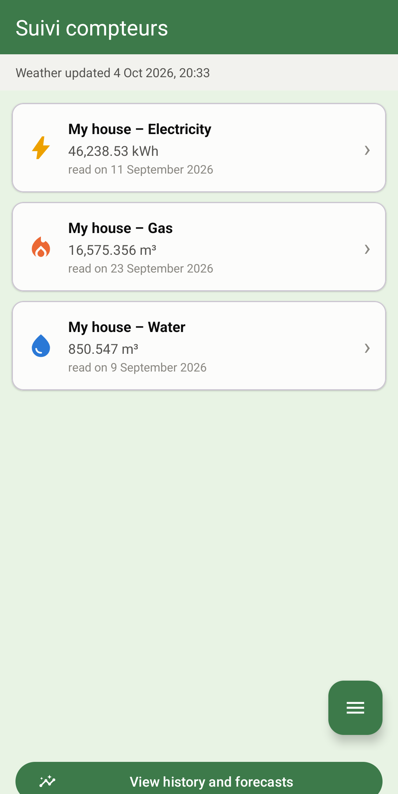
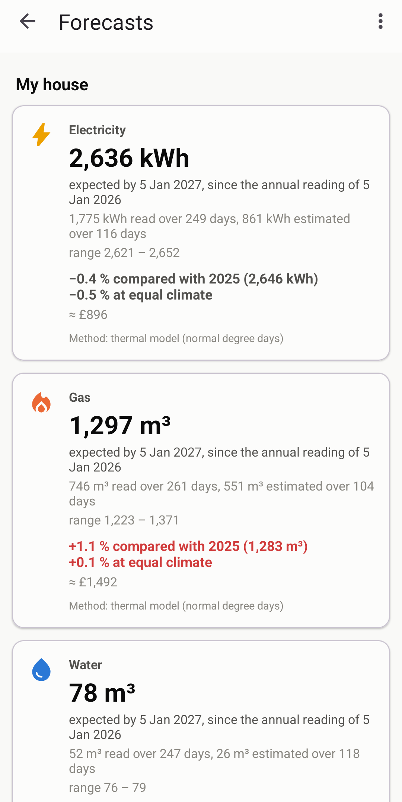
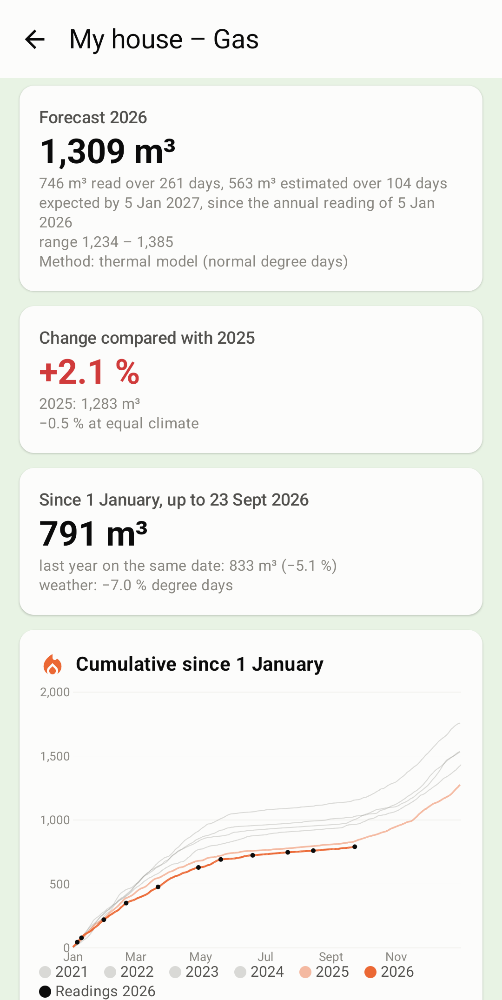
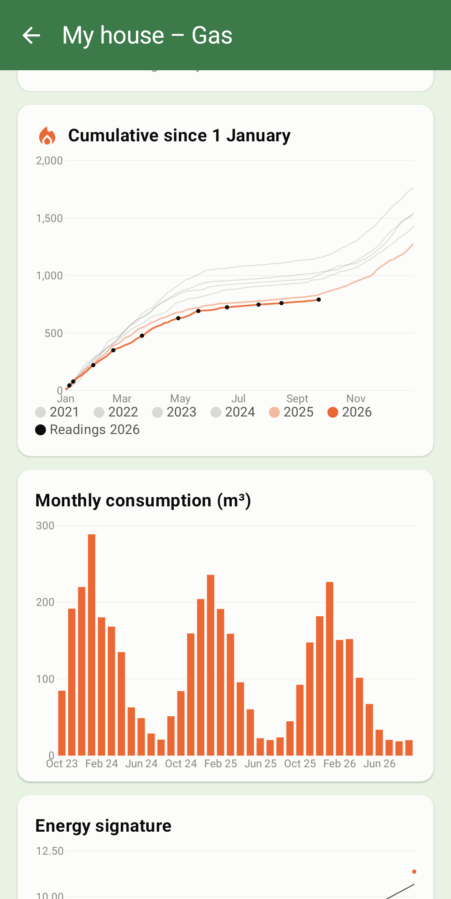
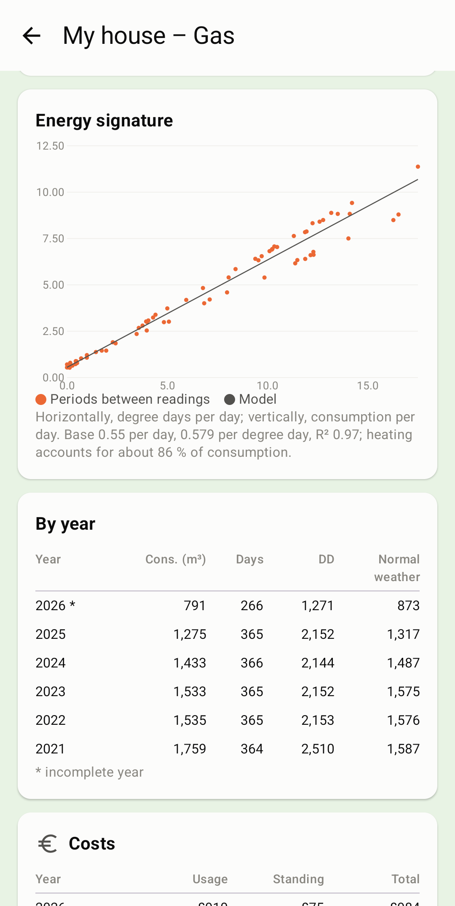
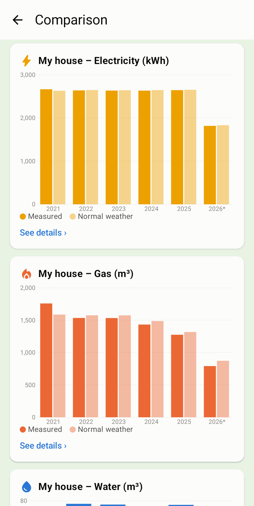
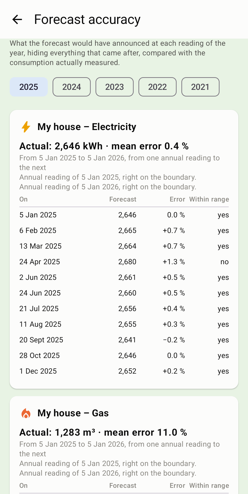
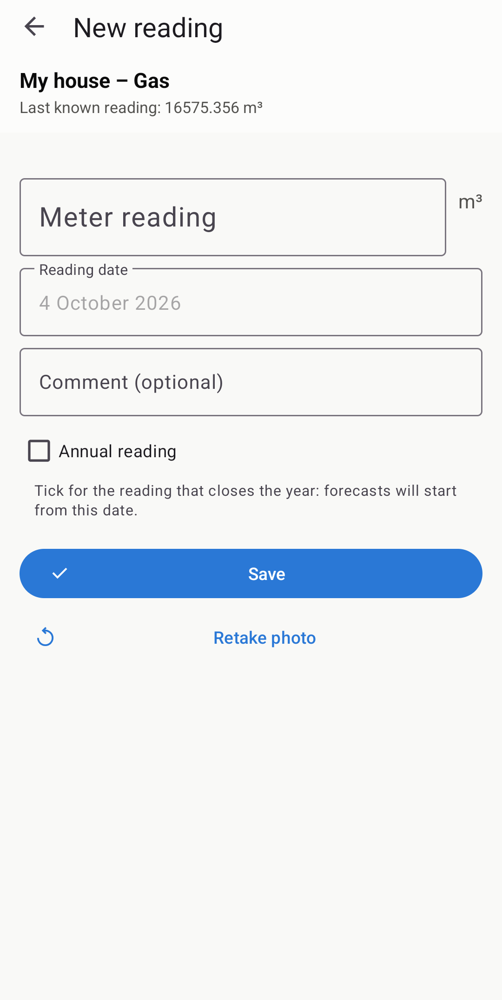

# Suivi compteurs

**English** · [Français](README.fr.md)

Android app for tracking water, gas, electricity and heating oil meters. It
gives you charts, a forecast for the year and a year-on-year comparison
**adjusted for degree days**, so that a harsh winter isn't mistaken for
consumption creeping up.

Free, with no account and no ads: all your data stays on your phone. The only
thing fetched from the internet is the weather, from
[Open-Meteo](https://open-meteo.com/).

**[Project page](https://dooliesoft.github.io/suivi_compteurs_project/)**
· **[⬇ Latest release](https://github.com/doolieSoft/suivi_compteurs_project/releases/latest)**
· **[♥ Donate](https://dooliesoft.github.io/suivi_compteurs_project/#soutenir)**

<table>
  <tr>
    <td width="25%"></td>
    <td width="25%"></td>
    <td width="25%"></td>
    <td width="25%"></td>
  </tr>
  <tr>
    <td align="center"><sub>Home: tap a meter to read it</sub></td>
    <td align="center"><sub>Forecasts for the year, with the trend over the last month</sub></td>
    <td align="center"><sub>Energy detail: forecast, trend, running total</sub></td>
    <td align="center"><sub>Monthly consumption, year by year</sub></td>
  </tr>
  <tr>
    <td width="25%"></td>
    <td width="25%"></td>
    <td width="25%"></td>
    <td width="25%"></td>
  </tr>
  <tr>
    <td align="center"><sub>Energy signature: consumption against the cold</sub></td>
    <td align="center"><sub>Years compared, as measured and at normal weather</sub></td>
    <td align="center"><sub>Accuracy of past forecasts</sub></td>
    <td align="center"><sub>Entering a reading</sub></td>
  </tr>
</table>

## Download

| Where | What |
|---|---|
| Google Play | automatic updates |
| [F-Droid](https://f-droid.org/packages/be.suivicompteurs.app/) | automatic updates, no proprietary components: you type the reading in by hand |
| [`suivi-compteurs.apk`](https://github.com/doolieSoft/suivi_compteurs_project/releases/latest/download/suivi-compteurs.apk) | with automatic reading from a photo (ML Kit) |
| [`suivi-compteurs-libre.apk`](https://github.com/doolieSoft/suivi_compteurs_project/releases/latest/download/suivi-compteurs-libre.apk) | no proprietary components: you type the reading in by hand |

To install an APK, open it from your phone's file manager and allow the
installation when Android asks. The three versions are signed differently, so
switching from one to another means uninstalling: export your data to Excel
first.

## What the app does

- record a meter reading, with automatic recognition from a photo that you
  always confirm;
- consistency checks: a meter doesn't run backwards, and a date holds only one
  reading;
- forecasts for the year, from one annual reading to the next or by calendar
  year;
- detail for each energy: running total, monthly consumption, energy signature,
  meter readings, years compared at normal weather, costs;
- comparison of years, weather, accuracy of past forecasts;
- several houses, meter replacement, tariffs, events (building work…);
- Excel import and export, which doubles as a backup (Google Drive included);
- reading reminders;
- French, English and Dutch; your choice of currency.

## How the numbers are calculated

The calculation engine is in
[`android/app/src/main/java/be/suivicompteurs/app/moteur/`](android/app/src/main/java/be/suivicompteurs/app/moteur/),
in pure Kotlin with no Android dependency.

### From readings to consumption

A reading records the number on the meter, not a consumption. Two readings may
be seven days apart or three hundred. To compare years, each difference between
readings is therefore spread over the days it covers (`Consommation.kt`).

Spreading it evenly is fine for water. For gas it's wrong: 300 m³ used between
October and March doesn't fall evenly across those months, it follows the cold.

### The thermal model

So the app fits a straight line, meter by meter:

```
consumption for the day = base + k × degree days for the day
```

- **`base`** covers what doesn't depend on the weather: hot water, cooking,
  standby power.
- **`k`** is the sensitivity to cold, in m³ (or kWh) per degree day. In essence,
  it's the thermal cost of the building.

The fit uses least squares weighted by the length of each period: a 300-day
period counts for more than a 7-day one. It's kept only if R² ≥ 0.5; otherwise
the app falls back to an even spread and says so.

The model is fitted **only for gas, heating oil and electricity**. Water
consumption follows how the home is occupied, not the weather: an apparent
correlation over a few years would be a coincidence, and "correcting" for it
would distort everything.

### The weather adjustment

Once `k` is known, each year is brought back to an average winter:

```
adjusted consumption = measured consumption + k × (normal DD − actual DD)
```

A colder-than-normal year therefore has its consumption revised downwards, and
vice versa. This adjusted figure is the one to compare from year to year.
**Normal DD** is the ten-year average for each calendar day.

### Forecasts

What was actually measured is never rewritten: only the days after the latest
reading are estimated (`Previsions.kt`).

- **Thermal model** (when it's reliable): the remaining days are estimated from
  the season's *normal* degree days, so a mild autumn isn't carried over into
  the following January.
- **Seasonal profile** (otherwise): past complete years show what fraction of
  the year's consumption has usually been used by this date, and the amount
  measured so far is divided by that fraction.

With an **annual reading**, the year runs from one anniversary of that reading
to the next. The gap between the actual reading date and that boundary is
estimated, so years stay comparable even if the reading slips by a few days.

The range shown reflects the spread between reference years, not the
uncertainty of the weather to come.

### Degree days

One degree day is `max(0, base − average temperature for the day)`. The base is
**16.5 °C**, the Belgian convention (DD 16.5/16.5).

Temperatures come from [Open-Meteo](https://open-meteo.com/) (CC BY 4.0), free
and with no API key: the historical data (ERA5 reanalysis) plus the forecast for
recent days, which the archive publishes a few days late. They update on their
own once a day.

## Development

Build, release, code layout and tests:
[android/README.md](android/README.md). Publishing on the Play Store:
[fastlane/PUBLIER.md](fastlane/PUBLIER.md); on F-Droid:
[fdroid/LISEZMOI.md](fdroid/LISEZMOI.md). These documents are in French.

The project started as a Django site; its engine was ported to Kotlin and the
site removed from the repository. It remains in the Git history, up to the tag
`v1.2.2`.

## Licence

© doolieSoft. Distributed under the GNU GPL version 3 or later: see
[LICENSE](LICENSE). You may use, modify and redistribute this software,
including selling it, provided that you publish the code of any modified
version you distribute under the same licence.

Icons: [Material Symbols](https://fonts.google.com/icons) by Google, under the
Apache 2.0 licence.
